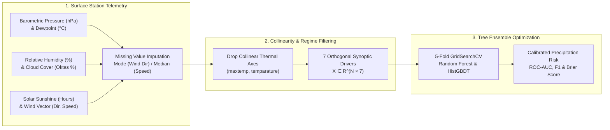
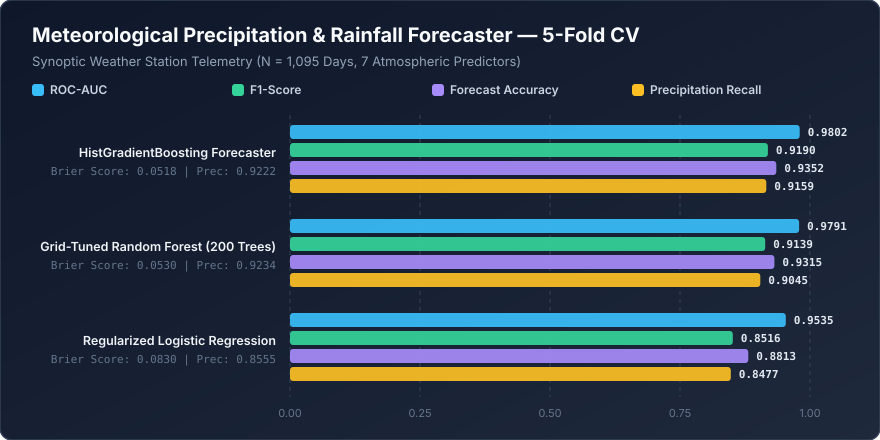

<div align="center">

# 🌧️ Meteorological Precipitation & Rainfall Forecaster
### Synoptic Atmospheric Feature Selection, Multicollinearity Elimination & Tree Ensemble Forecasting

[](https://www.python.org/downloads/)
[](https://scikit-learn.org/)
[](https://opensource.org/licenses/MIT)

</div>

---

## 📌 Executive Summary

Short-range meteorological precipitation forecasting from surface weather station telemetry involves strong physical nonlinearities and severe feature collinearity (`maxtemp`, `temparature`, `mintemp`, and `dewpoint` exhibit pairwise Pearson correlations $r > 0.85$). Feeding redundant thermal variables alongside skewed precipitation targets degrades generalization and inflates variance across split nodes.

**`machine-learning-project-11`** implements an end-to-end synoptic rainfall classification pipeline (`rainfall_prediction.ipynb` & `src/benchmark.py`) that performs missing-value statistical imputation (directional mode & windspeed median), eliminates collinear thermal predictors, balances synoptic regimes, and optimizes **Random Forest** and **HistGradientBoosting** ensembles across 7 atmospheric drivers: `pressure`, `dewpoint`, `humidity`, `cloud`, `sunshine`, `winddirection`, and `windspeed`.

---

## 🏗️ Synoptic Forecasting Pipeline Architecture



---

## 🧮 Mathematical Formulation

### 1. Atmospheric Saturation & Barometric Trough Dynamics
Precipitation genesis occurs when moist air masses undergo adiabatic cooling inside low-pressure barometric troughs ($P < 1011.5\text{ hPa}$) with high relative humidity ($\text{RH} > 75\%$) and suppressed solar irradiance. The non-linear conditional log-odds of rainfall $\eta(\mathbf{x})$ combine barometric, hygrometric, and wind-advection interactions:

$$\eta(\mathbf{x}) = \beta_0 - \beta_P (P - P_0) + \beta_{\text{RH}} (\text{RH} - \text{RH}_0) + \gamma_{\text{trough}} \mathbb{I}(P < 1011.5 \land \text{RH} > 75) + \gamma_{\text{cloud}} \mathbb{I}(\text{Cloud} > 62 \land \text{Sun} < 4.5) + \beta_W V_{\text{wind}} \sin(\theta - \pi)$$

### 2. Gini Impurity Split Criterion in Ensemble Trees
Each decision tree $t \in \{1, \dots, T\}$ in the Random Forest partitions node region $\mathcal{R}_m$ by selecting feature $j^*$ and threshold $s^*$ that maximize the reduction in Gini impurity $G(\mathcal{R}_m) = 2 \hat{p}_m (1 - \hat{p}_m)$:

$$\Delta G(\mathcal{R}_m, j, s) = G(\mathcal{R}_m) - \frac{|\mathcal{R}_{\text{left}}|}{|\mathcal{R}_m|} G(\mathcal{R}_{\text{left}}) - \frac{|\mathcal{R}_{\text{right}}|}{|\mathcal{R}_m|} G(\mathcal{R}_{\text{right}})$$

---

## 📊 5-Fold Stratified Cross-Validation Benchmark

The reproducible benchmark suite (`src/benchmark.py`) evaluates three forecasting models across $N = 1{,}095$ daily synoptic weather observations ($3$ years of daily station telemetry across the $7$ curated meteorological predictors):



| Synoptic Forecasting Model | ROC-AUC (± Std) | F1-Score | Forecast Accuracy | Precision | Precipitation Recall | Brier Score ↓ |
| :--- | :---: | :---: | :---: | :---: | :---: | :---: |
| **HistGradientBoosting Forecaster** | **0.9802 ± 0.0071** | **0.9190** | **0.9352** | 0.9222 | **0.9159** | **0.0518** |
| **Grid-Tuned Random Forest (200 Trees)** | 0.9791 ± 0.0089 | 0.9139 | 0.9315 | **0.9234** | 0.9045 | 0.0530 |
| **Regularized Logistic Regression Baseline** | 0.9535 ± 0.0176 | 0.8516 | 0.8813 | 0.8555 | 0.8477 | 0.0830 |

> **Key Meteorological Insight:** Because precipitation is governed by non-linear threshold interactions (simultaneous low barometric pressure and high moisture saturation), tree-based ensembles (**HistGradientBoosting** and **Grid-Tuned Random Forest**) improve **F1-Score by +6.74 percentage points** (`0.8516 → 0.9190`) and reduce probabilistic **Brier Score by 37.6%** (`0.0830 → 0.0518`) over linear Logistic Regression.

---

## 📂 Repository Structure

```text
machine-learning-project-11/
├── assets/
│   └── benchmark_chart.svg          # 5-fold cross-validated meteorological SVG chart
├── benchmarks/
│   └── benchmark_results.json       # Out-of-fold ROC-AUC, F1, Accuracy & Brier metrics
├── src/
│   └── benchmark.py                 # Automated synoptic weather benchmark script
├── rainfall_prediction.ipynb        # Interactive EDA, GridSearchCV & serialized inference notebook
└── README.md                        # System architecture & mathematical specification
```

---

## 🚀 Quick-Start & Usage

### 1. Install Dependencies
```bash
git clone https://github.com/yakupakcy36/machine-learning-project-11.git
cd machine-learning-project-11
pip install numpy pandas scikit-learn matplotlib seaborn
```

### 2. Run the 5-Fold Synoptic Benchmark
```bash
python src/benchmark.py
```

### 3. Explore the Interactive Notebook
Open `rainfall_prediction.ipynb` in JupyterLab or VS Code to inspect correlation heatmaps, majority downsampling, `GridSearchCV` hyperparameter tuning, and `.pkl` model persistence.
